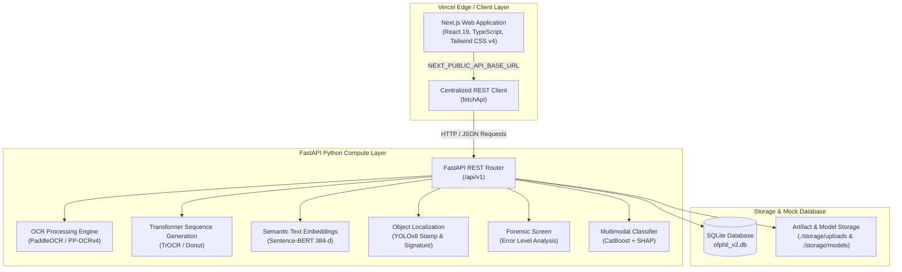

# OFPHIL Multimodal Charity Patient Eligibility Classification & OCR Suite (Version 2)

An experimental multimodal research platform and decision-support system developed for the **Ophthalmological Foundation of the Philippines (OFPHIL)**. Version 2 investigates decoupled, cloud-ready architectures combining a **Next.js frontend** (ready for Vercel deployment) with an isolated, high-performance **FastAPI Python backend** for deep document OCR, transformer models (**TrOCR**, **Donut**), **Sentence-BERT** embeddings, **YOLO** stamp/signature detection, and **CatBoost** tabular classification.

The primary monolithic application (`dss-charity-eligibity-classification`) serves as the visual and interaction reference, while Version 2 provides a modular, independently deployable architecture.

---

## 1. System Architecture



### Architecture Principles

1. **Frontend / Backend Decoupling**: The Next.js frontend is deployed independently on Vercel without embedding heavy machine learning weights or compute runtimes.
2. **Compute Isolation**: Vision transformers, OCR engines, and PyTorch/CatBoost pipelines reside strictly on the Python FastAPI compute backend.
3. **Zero Secret Leakage**: No private API keys or secret credentials exist in client bundles; all credentials are managed backend-side via `.env`.
4. **Synthetic Data Sandbox**: Designed specifically for synthetic data generation and experiment evaluation without exposing patient health records.

---

## 2. Technology Stack

- **Frontend**: Next.js 15, React 19, TypeScript, Tailwind CSS v4, Lucide React.
- **Backend API**: FastAPI, Uvicorn (ASGI), Pydantic v2, Pydantic Settings.
- **Data & Serialization**: SQLAlchemy, Python-Multipart, JSON Schema.
- **Python Runtime**: Python 3.12.10 x64.
- **Validation & Testing**: Pytest, Pytest-AsyncIO, HTTPX.
- **Interactive API Documentation**: Swagger UI (`/docs`), ReDoc (`/redoc`).

---

## 3. Environment Configuration

Version 2 maintains a clean separation between public frontend and private backend configuration files.

### Backend Environment (`backend/.env` and `.env`)

Template available in `backend/.env.example` and `.env.example`:

```env
APP_NAME="OFPHIL Classification V2"
APP_ENV=development
DEBUG=true
SECRET_KEY=your-secure-secret-key-min-32-chars
API_V1_PREFIX=/api/v1

DATABASE_URL=sqlite:///./ofphil_v2.db

# Private AI Credentials (Backend Only)
OPENAI_API_KEY=
OCR_API_KEY=
EMBEDDING_API_KEY=
DOCUMENT_ANALYSIS_API_KEY=

# Local Server & Network Endpoints
FRONTEND_URL=http://localhost:3000
BACKEND_URL=http://localhost:8000

# Storage Limits
MODEL_STORAGE_PATH=./storage/models
UPLOAD_STORAGE_PATH=./storage/uploads
MAX_UPLOAD_SIZE_MB=20
```

### Frontend Environment (`frontend/.env.local`)

Template available in `frontend/.env.example`:

```env
NEXT_PUBLIC_API_BASE_URL=http://localhost:8000/api/v1
NEXT_PUBLIC_APP_NAME="OFPHIL Classification V2"
```

> **Security Note:** All `.env` and `.env.local` files are ignored by Git. Never commit real credentials to version control.

---

## 4. Local Development Setup

### Prerequisites

- **Python**: 3.12.x (x64)
- **Node.js**: v20+ or v24+
- **Git**

### Step 1: Python Virtual Environment & Backend Setup

From the repository root:

```powershell
# 1. Activate the Python virtual environment
.\venv\Scripts\Activate.ps1

# 2. Install backend dependencies
pip install -r backend/requirements.txt

# 3. Configure environment
copy .env.example .env
copy backend\.env.example backend\.env
```

### Step 2: Start the FastAPI Backend

```powershell
# Run the FastAPI server with hot-reload enabled
python -m uvicorn app.main:app --app-dir backend --host 127.0.0.1 --port 8000 --reload
```

- **Health Check**: [http://127.0.0.1:8000/api/v1/health](http://127.0.0.1:8000/api/v1/health)
- **Interactive Swagger Docs**: [http://127.0.0.1:8000/docs](http://127.0.0.1:8000/docs)
- **ReDoc Documentation**: [http://127.0.0.1:8000/redoc](http://127.0.0.1:8000/redoc)

### Step 3: Frontend Setup & Execution

In a separate terminal:

```powershell
cd frontend

# 1. Install dependencies
npm install

# 2. Configure frontend local environment
copy .env.example .env.local

# 3. Start development server
npm run dev
```

Navigate to [http://localhost:3000](http://localhost:3000) to view the experimental web platform.

---

## 5. Experimental Modules Implemented

| # | Module | Route | Backend Endpoint | Functionality |
|---|---|---|---|---|
| **0** | **Dashboard & Metrics** | `/` | `/api/v1/health`, `/api/v1/datasets`, `/api/v1/experiments` | 6-card bento grid & experiment run tracking |
| **—** | **Auth State Demo** | `/login` | — | Role selection (Researcher, MSW, Admin) & session forms |
| **1** | **Synthetic Datasets** | `/datasets` | `/api/v1/datasets` | Tabular batch creation & metadata indexing |
| **2** | **Document Generator** | `/document-generation` | `/api/v1/documents` | Procedural rendering of synthetic certificates with official seals |
| **3** | **PaddleOCR Engine** | `/ocr` | `/api/v1/ocr` | Printed text recognition & structured key-value parsing |
| **4** | **Transformer OCR** | `/transformers` | `/api/v1/transformers` | TrOCR & Donut vision-encoder-decoder for cursive notes |
| **5** | **Semantic Embeddings** | `/embeddings` | `/api/v1/embeddings` | Sentence-BERT 384-dimensional vector coordinate generation |
| **6** | **Semantic Scoring** | `/semantic-scoring` | `/api/v1/semantic-scoring` | Continuous indigency index & clinical urgency evaluation |
| **7** | **YOLO Stamp Localization** | `/detection` | `/api/v1/detection` | Bounding-box verification for rubber stamps and signatures |
| **8** | **Manipulation Screening** | `/document-analysis` | `/api/v1/document-analysis` | Forensic Error Level Analysis (ELA) & tamper risk scoring |
| **9** | **CatBoost Classification** | `/classification` | `/api/v1/classification` | Multimodal eligibility decision tree inference |
| **10** | **SHAP Explainability** | `/explainability` | `/api/v1/explainability` | Local Shapley attribution waterfall breakdowns |
| **11** | **Experiment Benchmarks** | `/experiments` | `/api/v1/experiments` | Evaluation metrics (Accuracy, F1, ROC-AUC) across runs |
| **12** | **System & Environment** | `/settings` | `/api/v1/health` | Deployment boundary verification & config inspector |

---

## 6. Testing & Quality Assurance

### Run Backend Unit Tests

Run the test suite using `pytest`:

```powershell
$env:PYTHONPATH="backend"
.\venv\Scripts\pytest backend\tests -v
```

All 6 test cases validate health status, dataset generation, document tracking, OCR execution, CatBoost prediction, and input schemas.

### Production Build Verification

```powershell
cd frontend
npm run build
```

Builds an optimized, static Next.js production bundle with full type safety across all 14 routes.

---

## 7. Security & Privacy Guidelines

- **Synthetic Data Exclusivity**: Never load, process, or store real clinical records from the OFPHIL hospital or foundation into Version 2.
- **Git Security**: Verify that `.env`, `.env.local`, and SQLite files (`*.db`) are never committed to version control.
- **Vercel Readiness**: Ensure `NEXT_PUBLIC_API_BASE_URL` is set in the Vercel project dashboard to point to your deployed FastAPI backend URL.
