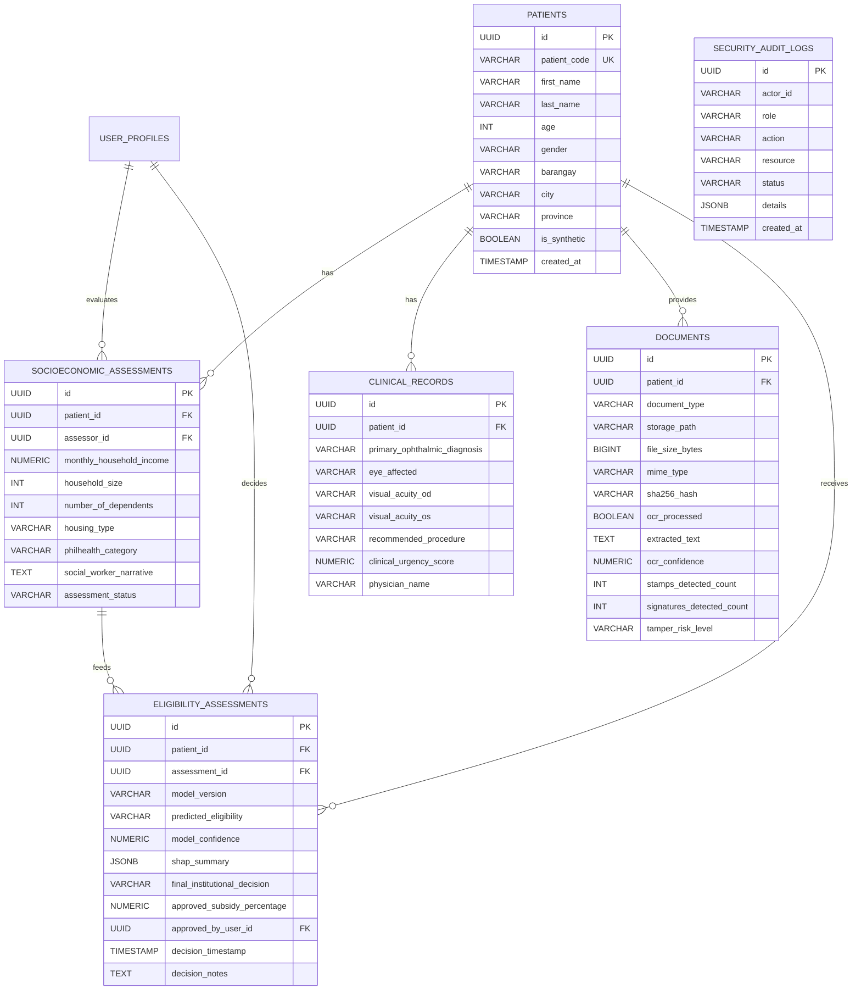

# OFPHIL Classification V2: Database Architecture Specification

## 1. Executive Summary

This document specifies the primary database architecture for **OFPHIL Classification V2 (`ofphil-classification-v2`)**. 

The architecture transitions from the legacy SQLite storage used in the primary reference project to an enterprise, cloud-native **Supabase PostgreSQL** instance.

The database is structured around normalized clinical, socioeconomic, multimodal document, and machine learning audit entities with native PostgreSQL Row Level Security (RLS) enforcement.

---

## 2. Architectural Blueprint



---

## 3. Directory Layout

The database code is localized inside the backend module:

```text
backend/app/database/
├── __init__.py
├── connection.py          # Centralized Supabase HTTP client & health monitoring
├── models/
│   ├── __init__.py
│   └── entities.py        # Declarative SQLAlchemy ORM entities
├── migrations/
│   ├── __init__.py
│   └── 001_initial_v2_schema.sql # Canonical SQL migration script
└── repositories/
    ├── __init__.py
    └── repositories.py    # Type-safe data access layer for patients & documents
```

---

## 4. Security & Row Level Security (RLS)

1. **Service Role Isolation**: Backend API calls utilize the `SUPABASE_SERVICE_ROLE_KEY` exclusively on the server side to bypass RLS for authorized compute routines.
2. **Anonymous / Client Protection**: Public anon keys cannot read sensitive clinical records unless authenticated with appropriate roles.
3. **Synthetic Data Partitioning**: Policies explicitly segregate synthetic test cohorts from future institutional patient records.
