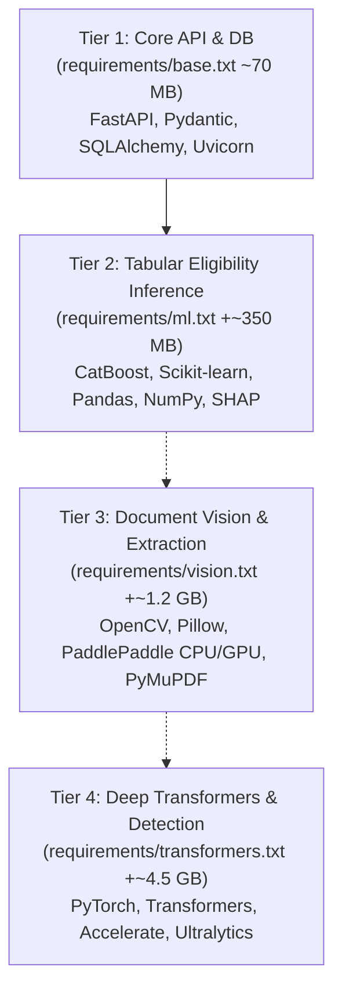

# OFPHIL V2 — Dependency Plan & Staged Runtime Architecture

**Version:** 2.0.0-draft  
**Target Repository:** `ofphil-classification-v2`  
**Current venv Footprint:** **66.16 MB** (Lean FastAPI microservice)  
**Reference Primary venv Footprint:** **7.50 GB** (PyTorch, Paddle, NVIDIA CUDA, OpenCV, Scientific stack)

---

## 1. Audit of Current V2 Backend Environment

The current backend virtual environment (`..\ofphil-classification-v2\venv`) was created strictly for the core API framework. Its total disk usage is only **66.16 MB**.

### Current Active Packages in V2:
- `fastapi` (0.165.0) & `uvicorn` (ASGI HTTP server)
- `pydantic` (2.10+) & `pydantic-settings` (type validation and configuration)
- `python-dotenv` & `python-multipart` (request parsing and environment)
- `sqlalchemy` (database ORM)
- `httpx` & `pytest` (API test harness)

**Verdict:** The current base environment is exceptionally clean and contains zero heavy machine learning bloat.

---

## 2. Planned Multi-Tier Dependency Architecture

To avoid exploding V2 from 66 MB to 7.5 GB, dependencies must be separated into **modular stages**. Heavy libraries (`torch`, `paddlepaddle`, `transformers`, `ultralytics`) must **NOT** be installed into the root requirements file. They must only be installed when their corresponding backend service modules are actively implemented and enabled.



### Tier 1: Core API & Database (Currently Installed ~70 MB)
**File:** `backend/requirements/base.txt`
```text
fastapi>=0.115.0
uvicorn[standard]>=0.32.0
pydantic>=2.10.0
pydantic-settings>=2.6.0
python-dotenv>=1.0.1
python-multipart>=0.0.18
sqlalchemy>=2.0.36
httpx>=0.28.0
pytest>=8.3.0
pytest-asyncio>=0.24.0
```
*Purpose:* Powers user authentication, session management, mock beneficiary stores, and REST endpoints.

---

### Tier 2: Tabular Eligibility Classification (Planned ~350 MB)
**File:** `backend/requirements/ml.txt`
```text
catboost>=1.2.7
numpy>=1.26.0
pandas>=2.2.0
scikit-learn>=1.5.0
shap>=0.45.0
joblib>=1.4.0
```
*Purpose:*
- Loads and evaluates `catboost_multimodal.cbm` (28 KB).
- Replaces legacy multi-model stacking (EBM + CatBoost) with a single, highly interpretable CatBoost classifier.
- Generates SHAP explanation values for healthcare workers.
*Estimated footprint:* **~350 MB** (vs 7.5 GB in the primary project).

---

### Tier 3: Document Vision, Preprocessing & PaddleOCR (Planned ~1.2 GB)
**File:** `backend/requirements/vision.txt`
```text
pillow>=10.4.0
opencv-python-headless>=4.10.0.84
pymupdf>=1.24.0
# Choose CPU or GPU based on deployment target:
paddlepaddle>=2.6.2; sys_platform == 'linux' or sys_platform == 'win32'
paddleocr>=2.8.0
```
*Purpose:*
- Image resizing, contrast enhancement, document orientation correction.
- Primary OCR text extraction using PP-OCRv4 / PP-OCRv6 recognition.
- Uses `opencv-python-headless` instead of full `cv2` to save GUI package bloat.
*Estimated footprint:* **~1.1 GB to 1.3 GB**.

---

### Tier 4: Heavy Vision Transformers & YOLO Localization (Optional / On-Demand ~4.5 GB)
**File:** `backend/requirements/transformers.txt`
```text
torch>=2.4.0
torchvision>=0.19.0
transformers>=4.45.0
sentencepiece>=0.2.0
sentence-transformers>=3.0.0
ultralytics>=8.3.0
```
*Purpose:*
- Vision-Encoder-Decoder handwriting extraction (TrOCR / Donut).
- Semantic dense text embeddings (`sentence-transformers/all-MiniLM-L6-v2`).
- YOLOv8 bounding-box detection for signatures, seals, and official hospital stamps.
*Estimated footprint:* **~4.5 GB to 5.0 GB** (primarily PyTorch Cuda/CPU shared libraries).

> [!IMPORTANT]
> **Tier 4 Installation Rule:** Do not install Tier 4 until the TrOCR and YOLO FastAPI routers (`/api/v1/extract/handwriting` and `/api/v1/detect/stamps`) are actively implemented with unit tests.

---

## 3. Dependency Mapping: Primary vs. V2

| Primary Dependency | Primary Size | Status in V2 | V2 Decision & Rationale |
| :--- | :--- | :--- | :--- |
| `torch` + `torchvision` | 4,251 MB | **Deferred to Tier 4** | Keep out of base image until TrOCR/Donut service is written. |
| `paddle` (PaddlePaddle) | 1,052 MB | **Deferred to Tier 3** | Only install when `/api/v1/ocr` router is actively implemented. |
| `nvidia-*` (CUDA 12 wheels) | 594 MB | **Excluded in Base** | In local CPU or cloud CPU containers, install CPU-only wheels (`--index-url https://download.pytorch.org/whl/cpu`). |
| `catboost` | 321 MB | **Required in Tier 2** | Primary classification engine; highly performant C++ gradient booster. |
| `cv2` (opencv-python) | 151 MB | **Replaced** | Replace with `opencv-python-headless` (omits unnecessary GUI backends). |
| `interpret` (EBM) | 68 MB | **Excluded** | Dropped; simplifies model stack to pure CatBoost. |
| `xgboost` | 56 MB | **Excluded** | Redundant; CatBoost handles tabular trees natively. |
| `dash` + `plotly` | 68 MB | **Excluded** | Frontend visualization is now offloaded entirely to Next.js / Tailwind UI. |
| `modelscope` | 22 MB | **Excluded** | Primary project research dependency not needed in V2. |

---

## 4. Proposed Directory Layout for Backend Requirements

```
backend/
├── requirements.txt            # Master reference (pointing to requirements/base.txt)
└── requirements/
    ├── base.txt                # Tier 1: FastAPI, Pydantic, SQLAlchemy (~70 MB)
    ├── ml.txt                  # Tier 2: CatBoost, Scikit-learn, SHAP (~350 MB)
    ├── vision.txt              # Tier 3: PaddleOCR, OpenCV-headless (~1.2 GB)
    └── transformers.txt        # Tier 4: PyTorch, Transformers, Ultralytics (~4.5 GB)
```
