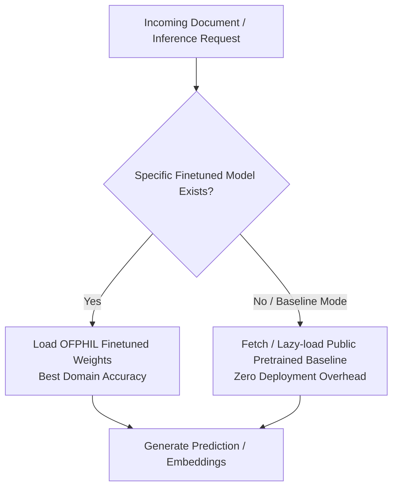

# OFPHIL V2 — Model Manifest & Reuse Specification

**Version:** 2.0.0-draft  
**Target Repository:** `ofphil-classification-v2`  
**Reference Source:** `dss-charity-eligibity-classification`  
**Canonical Storage Directory:** `storage/models/` (Local compute layer, Git-ignored)  
**Execution Guardrail:** Planning specification. No model weights were copied, moved, or downloaded during this analysis.

---

## 1. Executive Strategy & Model Architecture Scope

OFPHIL V2 adopts a decoupled, modern architecture (Next.js frontend + FastAPI compute backend). In accordance with the project directives:
1. **Classification Architecture:** **CatBoost** is selected as the sole machine learning model for tabular charity patient eligibility classification.
2. **Explicit Exclusions:** **Explainable Boosting Machine (EBM)** (`ebm_multimodal.joblib`) and all historical training checkpoints (`checkpoint_epoch_[1-5]`) are strictly excluded from V2 to keep deployment lean.
3. **Modularity:** Heavy vision pipelines (PaddleOCR, TrOCR, Sentence-BERT, YOLOv8) are treated as pluggable backend extensions, lazy-loaded on demand only when explicit document extraction endpoints are called.
4. **Zero-Copy & Baseline Principles:** Models may be referenced via canonical paths or initialized with public pretrained baselines on demand. No patient data or proprietary documents accompany model weights.

---

## 2. Canonical Model Manifest

| Model Name / Identifier | Provider / Origin | Architecture & Version | Source | Canonical Target Path | Checksum (SHA-256) | Operational Purpose | License |
| :--- | :--- | :--- | :--- | :--- | :--- | :--- | :--- |
| **`catboost_multimodal.cbm`** | Yandex / OFPHIL Project | CatBoost Gradient Boosting (v1.2+) | `dss-charity-eligibity-classification/models/multimodal/catboost_multimodal.cbm` | `storage/models/classification/catboost_multimodal.cbm` | `1FFDAAA84479558CC24B0CE6F2B456B5EBDB6E6E869C48312BF46B33E5358189` | Sole tabular classifier for patient charity eligibility scoring (Clinical & Socioeconomic features). | Apache-2.0 |
| **`paddleocr_rec_ppocrv6`** (Finetuned) | Baidu / OFPHIL Project | PaddleOCR SVTR / PP-OCRv6 Recognition | `dss-charity-eligibity-classification/models/paddleocr_ofphil_finetuned/recognition/best_accuracy/` | `storage/models/ocr/paddleocr_ofphil_finetuned/` | `inference.pdiparams`: `2BD103D5C64B5A3A685AAA18288289F7D842A01F34B4C3B492FBCEE122250497` `model_weights.pdparams`: `B95B7B4F7403DFCED6A646BECC36DCCC7E2119903FB070A60F958403D3D96E8A` | Primary text recognition engine for structured Philippine medical and indigency certificates. | Apache-2.0 |
| **`paddleocr_ppocrv4_base`** (Public Baseline Alternative) | PaddlePaddle Open Source | PP-OCRv4 Mobile Detection & Recognition | Upstream PaddlePaddle Model Hub (`ppocrv4_rec`, `ppocrv4_det`) | `~/.paddleocr/` or `storage/models/ocr/paddleocr_base/` | Dynamic / Verified on download by PaddleOCR hub | General out-of-the-box OCR baseline when OFPHIL finetuned weights are omitted. | Apache-2.0 |
| **`trocr_ofphil_finetuned`** | Microsoft / OFPHIL Project | TrOCR Small / Base (VisionEncoderDecoder) | `dss-charity-eligibity-classification/models/trocr_ofphil_finetuned/` | `storage/models/ocr/trocr_ofphil_finetuned/` | `model.safetensors`: `83581C31450A77072374BFA37976A26E10B7E383A255C090A7E90C2AEC7F822D` | Specialized handwriting transcription for handwritten physician notes and signatures. | MIT / Apache-2.0 |
| **`microsoft/trocr-base-handwritten`** (Public Baseline Alternative) | Microsoft Research | Vision-Encoder-Decoder (BEiT + RoBERTa) | Hugging Face Hub: `microsoft/trocr-base-handwritten` | Hugging Face Cache / `storage/models/baselines/trocr-base-handwritten/` | Verified by Hugging Face Hub commit hash | Off-the-shelf baseline for handwriting transcription prior to local weight loading. | Apache-2.0 |
| **`sentence-transformers/all-MiniLM-L6-v2`** | sentence-transformers | BERT 6-layer 384-dimensional dense encoder | Hugging Face Hub: `sentence-transformers/all-MiniLM-L6-v2` | `storage/models/embeddings/all-MiniLM-L6-v2/` | Verified by Hugging Face Hub (`e4ce98778...`) | Fast semantic vectorization of extracted clinical text abstractions and social case diagnoses. | Apache-2.0 |
| **`yolov8n-document-detect`** | Ultralytics / Custom | YOLOv8 Nano (`yolov8n.pt`) | Ultralytics Hub / Custom Stamp Detector | `storage/models/detection/yolov8n.pt` | Verified on download by Ultralytics API | Fast bounding box localization for hospital stamps, signatures, and document seal artifacts. | AGPL-3.0 / Enterprise |

---

## 3. Finetuned vs. Public Pretrained Baseline Analysis

For every vision and NLP module in V2, evaluate whether a generic public pretrained model can serve as the default baseline before deploying specialized OFPHIL weights:

### 1. Tabular Classifier (CatBoost)
- **Baseline Feasibility:** **None**. Tabular patient eligibility classification is strictly domain-specific. No generic off-the-shelf foundation model exists for OFPHIL socioeconomic criteria.
- **Decision:** **Reuse `catboost_multimodal.cbm` (28 KB)** from the primary project. It is tiny, ultra-fast, and contains zero PII or raw patient data.

### 2. Primary Text Recognition (PaddleOCR)
- **Baseline Feasibility:** **High**. The default public `PP-OCRv4` model (downloaded automatically by `PaddleOCR(lang="en")`) achieves solid baseline OCR performance on clean digital scans.
- **Finetuned Benefit:** The OFPHIL-finetuned recognition checkpoint (`best_accuracy`, 73.27 MB) improves character accuracy on low-contrast municipal seal stamps, local health center carbon copies, and cursive notes.
- **Decision:** Support **dual-mode**: default to generic `PaddleOCR` base; automatically switch to `storage/models/ocr/paddleocr_ofphil_finetuned` if local weights exist.

### 3. Handwriting OCR (TrOCR)
- **Baseline Feasibility:** **High**. `microsoft/trocr-base-handwritten` or `microsoft/trocr-small-handwritten` can be pulled on-demand from Hugging Face (`~1.2 GB`).
- **Finetuned Benefit:** `trocr_ofphil_finetuned` was adapted specifically to physician cursive on medical intake forms.
- **Decision:** In V2, keep TrOCR as an **optional, on-demand component**. When enabled in development or CI, use the lightweight Hugging Face baseline or symlink to `models/trocr_ofphil_finetuned`. Do not bundle weights in the Git repository.

### 4. Semantic Text Embeddings (Sentence-BERT)
- **Baseline Feasibility:** **Full**. Standard public `all-MiniLM-L6-v2` (`~80 MB`) provides 384-dimensional embeddings without any need for local finetuning.
- **Decision:** Use the public pretrained baseline on-demand.

---

## 4. Models Excluded from V2

1. **`models/multimodal/ebm_multimodal.joblib` (7.62 MB):**  
   - *Reason:* Dropped per architecture guidelines to standardize on CatBoost as the single, high-performance gradient-boosting inference model with native categorical feature support and SHAP interpretability.
2. **`models/trocr_progressive_checkpoints/` (6.24 GB):**  
   - *Reason:* Historical epochs 1 through 5 are training checkpoints. Epoch 5 is an exact duplicate of `trocr_ofphil_finetuned`, and epochs 1–4 are historical training milestones unneeded for inference.
3. **`models/paddleocr_ofphil_finetuned/recognition/latest_checkpoint/` (219 MB):**  
   - *Reason:* Contains `optimizer.pdopt` (145.9 MB) and duplicate weights (72.9 MB) only relevant for ongoing backpropagation.
4. **ResNet-50 Precomputed Embeddings (`resnet50_document_embeddings.npy`, 10.4 MB):**  
   - *Reason:* V2 transitions from legacy ResNet CNN embeddings to modern document transformers / text embeddings (Donut or MiniLM).
