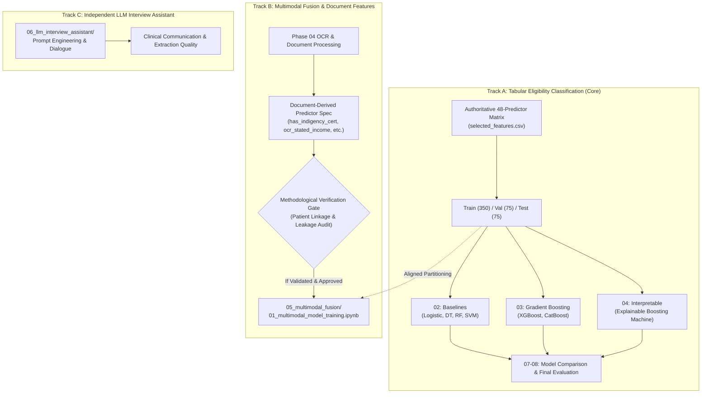

# Phase 05 Multimodal Transition Plan & Architecture

**Project**: `ofphil-classification-v2`  
**Pipeline Track**: Phase 05 – Model Selection, Training, and Multimodal Fusion  
**Document Purpose**: Define the methodological bridge between Phase 04 (Document Processing & OCR) and Phase 05 (Model Training).

---

## 1. Architectural Overview & Separation of Concerns

Phase 05 contains two primary tracks that must remain architecturally distinct:

### Critical Rules
1. **The Tabular Baseline is the Benchmark**: Traditional and gradient boosting models must be trained and evaluated *first* using the locked 48-predictor tabular matrix (`selected_features.csv`).
2. **Multimodal Fusion is Experimental**: Multimodal models must compare their performance directly against the pure tabular baseline to measure genuine incremental value ($\Delta \text{AUC}$, $\Delta F_1$, calibration gain).
3. **LLM Assistant is Non-Classifier**: Track C (LLM Interview Assistant) is an interactive caseworker tool, not an eligibility classifier. Its evaluation metrics (ROUGE, BLEU, clinical communication appropriateness) must never be blended with tabular classification metrics.

---

## 2. Document-Derived Feature Evaluation & Leakage Screening

Before any document-derived indicator from Phase 04 is admitted into a multimodal model, it must pass a strict four-point test:

| Candidate Document Feature | Extracted Modality | Intake Availability | Target Leakage Assessment | Admissibility Disposition |
| :--- | :--- | :--- | :--- | :--- |
| `has_certificate_of_indigency` | Detection / OCR | Available at initial intake | **HIGH-RISK PROXY**: Strongly collinear with administrative grant; high risk of shortcut learning. | **QUARANTINED** (Excluded from baseline; optional sensitivity analysis only). |
| `has_valid_government_id` | Classification | Available at initial intake | Low leakage risk; measures applicant administrative completeness. | **ADMISSIBLE** for multimodal experiments. |
| `has_referral_letter` | Classification | Available at intake triage | Low leakage risk; reflects institutional referral route. | **ADMISSIBLE** for multimodal experiments. |
| `has_philhealth_document` | Classification | Available at intake triage | Low leakage risk; reflects national health insurance coverage status. | **ADMISSIBLE** for multimodal experiments. |
| `ocr_stated_monthly_income` | OCR text extraction | Available if payslip/certificate presented | May conflict with self-reported interview income; valuable for discrepancy checking. | **ADMISSIBLE** with explicit missingness indicator. |
| `doc_completeness_ratio` | Aggregate inventory count | Computed at intake completion | Administrative proxy; must be audited against class balance. | **RESTRICTED** to multimodal exploration. |
| `document_authenticity_score` | Forensic ELA / CNN | Computed post-capture | Must not be used to disqualify eligibility automatically. | **DIAGNOSTIC ONLY** (caseworker review flag). |

---

## 3. Patient Record Linkage & Split Alignment Protocol

To prevent cross-partition contamination when combining tabular patient records with document features:

1. **Alignment Key**: Linkage must occur strictly via `patient_id` / `internal_record_id`.
2. **Partition Preservation**:
   - Any document associated with a patient in `split_partition == 'train'` must reside solely in the multimodal training split.
   - Any document associated with a patient in `split_partition == 'validation'` or `'test'` must never be seen during multimodal representation learning or tabular training.
3. **Missing Document Strategy**:
   - For patients with unsubmitted or physical-only documents, document feature vectors must be imputed with explicit indicator flags (`is_doc_missing = 1.0`), never with arbitrary synthetic values.

---

## 4. Phase 05 Notebook Execution Sequence

When the user transitions to executing Phase 05 in JupyterLab:

1. **Step 1: Training Data Setup**  
   Execute `01_training_data_setup.ipynb` to verify that `selected_features.csv` loads with 350 train, 75 val, and 75 test rows.
2. **Step 2: Baseline Model Suite**  
   Execute `02_baseline_models/` (Logistic Regression, Decision Tree, Random Forest, SVM) to establish non-linear and linear baselines.
3. **Step 3: Gradient Boosting Suite**  
   Execute `03_gradient_boosting_models/` (XGBoost, CatBoost) with 5-fold stratified cross-validation on the training set.
4. **Step 4: Interpretable Models**  
   Execute `04_interpretable_models/01_explainable_boosting_machine.ipynb` for generalized additive model (GAM) interpretability.
5. **Step 5: Multimodal Fusion (Optional / Advanced)**  
   Execute `05_multimodal_fusion/01_multimodal_model_training.ipynb` only after Phase 04 document extraction features have been generated and audited.
6. **Step 6: LLM Interview Assistant Evaluation**  
   Execute `06_llm_interview_assistant/` independently to evaluate qualitative casework dialogues.
7. **Step 7: Final Comparison & Reporting**  
   Execute `07_model_comparison_and_tuning.ipynb` and `08_final_model_evaluation.ipynb` to evaluate the winning model on the sequestered test split.
