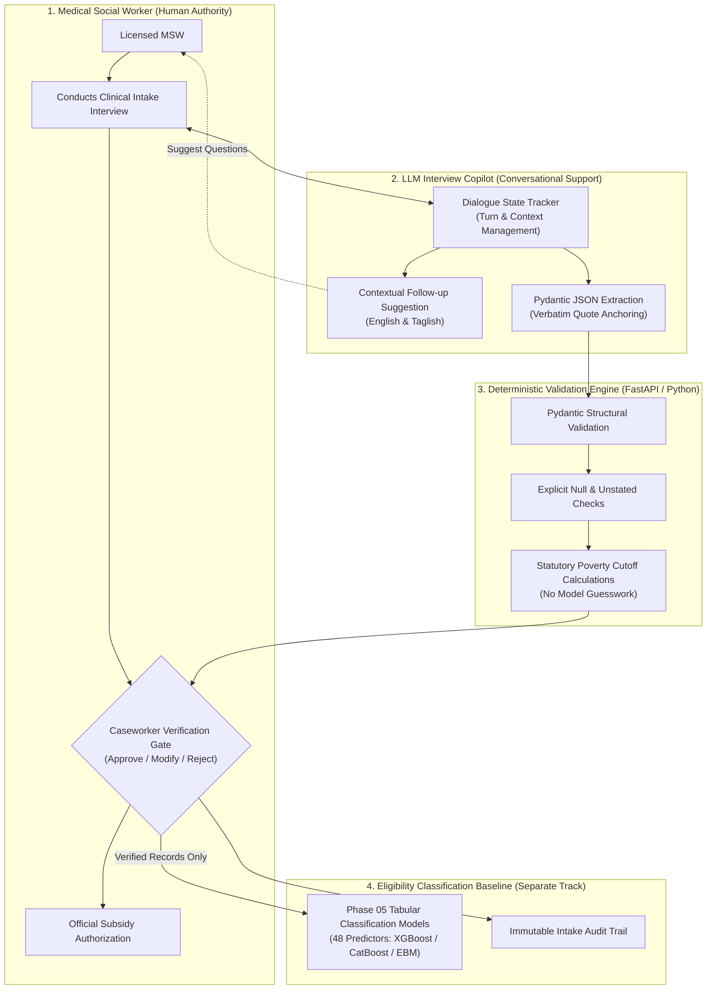

# LLM Interview Assistant System Architecture

**Project**: `ofphil-classification-v2`  
**Pipeline Track**: Phase 05 – Stage 2 MSW Interview Assistant  
**Architectural Pattern**: Modular Clinical Social Work Copilot Pipeline (Human-in-the-Loop)

---

## 1. System Responsibilities & Boundaries

The OFPHIL V2 architecture enforces a strict four-layer separation of concerns:

---

## 2. Layer Responsibilities & Strict Governance Boundaries

### A. Large Language Model (Ollama Local Runtime)
- **Role**: Operates strictly under the **MSW Interview Assistant system prompt**.
- **Permitted Functions**:
  - Suggesting culturally respectful follow-up questions in Filipino/Taglish and English.
  - Resolving ambiguous conversational disclosures in intake dialogue.
  - Extracting disclosed numbers, assets, and quotes into structured JSON schemas.
- **Prohibited Functions**:
  - Assigning charity eligibility classifications (`ELIGIBLE` / `INELIGIBLE`).
  - Calculating subsidy percentages or patient co-pay amounts.
  - Overriding or synthesizing unstated patient disclosures.
  - Computing automated patient severity scores.

### B. Deterministic Validation Engine (Python / FastAPI)
- Performs schema validation using Pydantic.
- Enforces data type constraints and flags missing fields as explicit `null`s.
- Calculates objective per-capita brackets against statutory poverty thresholds without using probabilistic model inferences.

### C. Medical Social Worker (Human Authority)
- Directs the interview and maintains the patient relationship.
- Reviews and edits all AI-extracted information in the clinical dossier.
- Retains sole legal and institutional authority for subsidy recommendations.

### D. Eligibility Classification Pipeline (Independent Track)
- Consumes verified records from the human caseworker and validated tabular feature pipelines.
- Operates independently of conversational LLM text generations.

---

## 3. Standardized Candidate Model Matrix & Evaluation Protocols

All four candidate models are evaluated using identical test scenarios, prompt templates, and evaluation rubrics:

| Candidate Model | Role & Priority | Ollama Tag | Native Context | Quantization & Published Size | Runtime Execution Profile (RTX 3050 4GB + 32GB RAM) |
| :--- | :--- | :--- | :---: | :---: | :--- |
| **Qwen3 4B Instruct** | Initial Testing Candidate | `qwen3:4b` | 32k | Q4_K_M (~2.5 GB) | Primary testing candidate; probable partial / near-full GPU fit depending on KV cache headroom. |
| **Phi-4-mini Instruct** | Lightweight Comparison | `phi4-mini` | 128k | Q4_K_M (~2.5 GB) | Compact logic and schema comparison candidate; near-full GPU fit with system RAM buffer. |
| **Qwen3 8B Instruct** | Higher-Capacity Comparison | `qwen3:8b` | 32k | Q4_K_M (~5.2 GB) | Advanced conversational comparison; requires hybrid CPU/GPU offloading (~20-24 layers in VRAM). |
| **Gemma 3 12B Instruct** | Optional Heavy Comparison | `gemma3:12b` | 128k | Q4_K_M (~8.2 GB) | Deep reasoning comparison; requires heavy host RAM offloading (>70% layers in RAM). |
