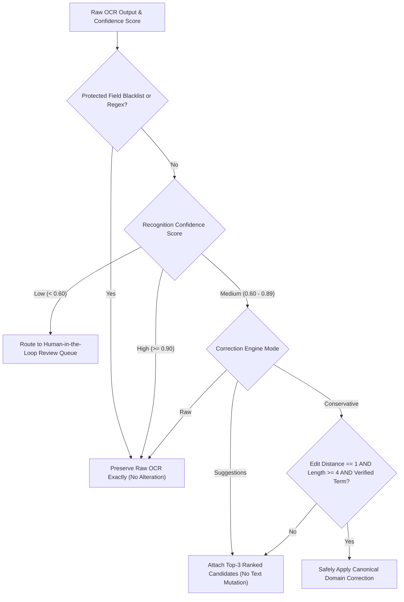

# Phase 04 Assisted English-Filipino-OFPHIL Domain Dictionary Design

**Project:** `ofphil-classification-v2`  
**Phase:** 04 — Document Processing and OCR  
**Date:** November 24, 2026  

---

## 1. Design Principles & Architecture

The Assisted Domain Dictionary provides high-precision post-processing correction and suggestion generation for optical character recognition in the OFPHIL pipeline without modifying the pre-trained neural network weights.

### 1.1 Structural Organization

The dictionary ecosystem is located under `data/external/paddleocr/dictionaries/`:
- `character/`: Comprehensive character sets and coverage metadata (`character_dictionary.txt`, 114 chars).
- `vocabulary/`: Domain-specific terminology text files across 7 categories.
- `domain/`: Unified canonical dictionary (`ofphil_domain_dictionary.csv`, `ofphil_domain_dictionary.json`), approved abbreviations, and terminology review logs.
- `correction/`: Operational rules (`correction_rules.json`), character confusion maps, and confidence routing policies.
- `evaluation/`: Synthetic and anonymized benchmark test cases.

---

## 2. Multi-Mode Correction Engine

### 2.1 Mode Definitions
1. **Raw Mode:** Strictly passes raw OCR outputs without applying any dictionary lookups or replacements.
2. **Suggestions Mode:** Computes Levenshtein distance between unrecognized tokens and domain terminology, attaching the top-3 closest candidates with confidence rankings without altering the underlying text.
3. **Conservative Mode:** Automatically substitutes a recognized token only when:
   - Edit distance equals 1.
   - Token length $\ge 4$ characters.
   - Token does not match protected entities (names, dates, currency, IDs).
   - Candidate is verified in the canonical domain dictionary.
   - OCR confidence is between $0.60$ and $0.89$.

---

## 3. Protected Field Safeguards

To prevent catastrophic hallucinations or semantic distortion of critical clinical data, the engine enforces strict blacklist protection on:
- Patient Names (First, Middle, Last)
- Case and Hospital Record Numbers
- Financial Values (Income, Charity Subsidies, Total Costs)
- Dates (Birth, Admission, Interview)
- Official Receipt Numbers

Any token matching protected regex expressions (`^\d+$`, `^PHP\s*[0-9,.]+$`, `^\d{2}/\d{2}/\d{4}$`) is completely exempted from post-OCR automated mutation.
