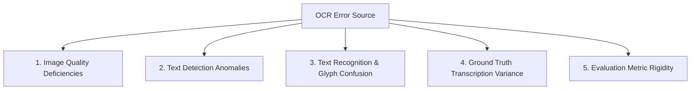

# Phase 04 OCR CER/WER Error Analysis Plan and Diagnostic Framework

**Project:** `ofphil-classification-v2`  
**Phase:** 04 — Document Processing and OCR  
**Date:** November 24, 2026  

---

## 1. Overview and Objectives

This plan formalizes a 5-dimensional diagnostic framework designed to systematically isolate, classify, and address errors in optical character recognition across OFPHIL clinical and intake documents.

---

## 2. Five Diagnostic Dimensions

### 2.1 Dimension 1: Image Quality Deficiencies
- **Carbon Copies & Faded Ink:** Medical Social Service intake sheets frequently use carbonless duplicate paper, resulting in broken strokes and low contrast.
- **Skew and Rotation:** Scanned multi-page PDF documents exhibit $\pm 2^\circ$ to $\pm 10^\circ$ rotational skew.
- **Shadowing & Creases:** Mobile captures and folded intake sheets introduce uneven illumination across document margins.

### 2.2 Dimension 2: Text Detection Anomalies
- **Tight Bounding Box Clipping:** DBNet polygon outputs occasionally clip ascenders (e.g., `t`, `d`, `h`) or descenders (`g`, `y`, `p`).
- **Checkbox-Text Disconnection:** Bounding boxes segment checkbox squares separately from their accompanying descriptive labels.
- **Table Column Cross-Merging:** Multi-column financial assessments merge adjacent columns into a single horizontal bounding box.

### 2.3 Dimension 3: Text Recognition & Glyph Confusion
- Single-character visual confusion: `0` $\leftrightarrow$ `O`, `1` $\leftrightarrow$ `I` / `l`, `5` $\leftrightarrow$ `S`, `8` $\leftrightarrow$ `B`.
- N-gram split/merge confusion: `rn` $\leftrightarrow$ `m`, `cl` $\leftrightarrow$ `d`, `vv` $\leftrightarrow$ `w`.
- Out-of-vocabulary medical nomenclature: Special ophthalmological conditions (e.g., `pterygium`, `phacoemulsification`) default to high-confidence phonetic approximations.

### 2.4 Dimension 4: Ground Truth Transcription Variance
- Whitespace variations: Single space vs. double spaces, trailing line breaks.
- Casing inconsistency: Capitalized headers transcribed in sentence case in annotations.
- Checkbox formatting conventions: Inconsistent usage of `[X]`, `[✓]`, `( )`, and `[ ]`.

### 2.5 Dimension 5: Evaluation Metric Rigidity
- Lack of case-folding and punctuation normalization in standard CER/WER metrics artificially exaggerates error rates by treating typographical case mismatches identically to missing clinical terms.

---

## 3. Systematic 15-Class OCR Error Taxonomy

| Code | Taxonomy Class | Description |
|---|---|---|
| `E01` | Handwritten Mismatch | Printed model failing on cursive or block handwriting |
| `E02` | Checkbox Glyph Dropping | Checkbox icon recognized without textual label |
| `E03` | Casing Sensitivity Inflation | Discrepancy solely attributable to uppercase vs lowercase |
| `E04` | Punctuation / Special Chars | Missing or mismatched commas, periods, hyphens |
| `E05` | Digit / Letter Confusion | Visual similarity substitution (e.g. `O` for `0`, `l` for `1`) |
| `E06` | Filipino Diacritic / Token Gap | Taglish particles or hyphenated Filipino words split improperly |
| `E07` | Clinical Terminology OOV | Medical terms absent from generic language dictionaries |
| `E08` | Detection Box Clipping | Bounding box truncating starting or ending glyphs |
| `E09` | Skew / Orientation Defect | Uncorrected skew causing diagonal slice misreads |
| `E10` | Low Resolution Blur | Heavy blur causing stroke merging |
| `E11` | Carbon Copy / Faded Ink | Low stroke contrast below binarization threshold |
| `E12` | Column Cross-Merge | Text across two tabular columns merged into one text line |
| `E13` | Whitespace Collapse | Tab or multi-space separation collapsed into single space |
| `E14` | Abbreviation Splitting | Standard acronyms split into separate tokens |
| `E15` | Protected Field Alteration | Accidental mutation of critical identifiers or monetary amounts |
