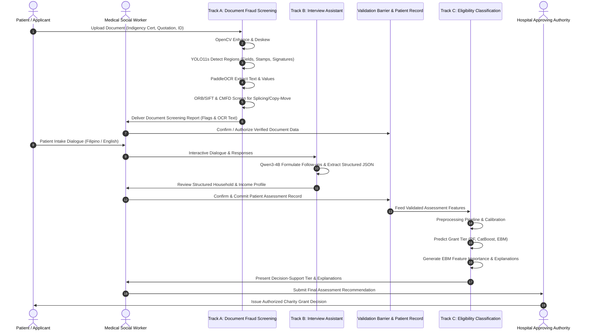

# OFPHIL Overall Integrated Data Pipeline

## 1. End-to-End Multimodal Integration Workflow

The OFPHIL architecture couples document screening, structured conversational intake, and tabular eligibility modeling via an explicit data validation barrier.

---

## 2. Information Exchange Boundaries

1. **Document Screening $\rightarrow$ Assessment Record:**
   - Visual inspection flags (e.g. high CMFD score, missing stamp) do not abort the intake. They are logged as inspection indicators for the MSW to review original hard copies.
   - Verified quotation totals, endorsing doctor names, and barangay details populate the pending assessment record once confirmed.

2. **Patient Interview $\rightarrow$ Assessment Record:**
   - Raw chat transcripts are converted to standardized JSON schemas (household size, total monthly income, dependents, housing type).
   - The MSW reviews and commits the data. Unconfirmed LLM output is never forwarded directly to Track C.

3. **Assessment Record $\rightarrow$ Eligibility Classification:**
   - Track C receives normalized numerical and categorical vectors.
   - Classification output (Eligible/Ineligible, Subsidy Tier 25%-100%) and feature explanations are provided as decision aids.
