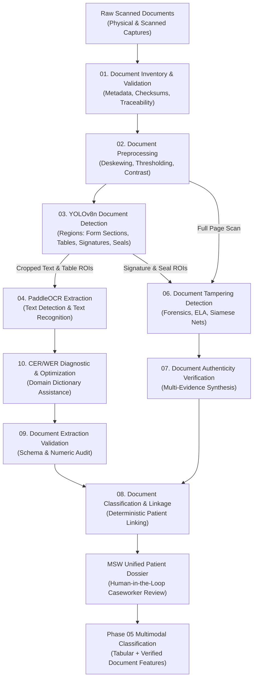

# OFPHIL V2 — Phase 04 Final Implementation and Integration Report: Document Processing & OCR

**Date:** November 24, 2026  
**Project:** `ofphil-classification-v2`  
**Phase:** Phase 04 — Document Processing and OCR  
**Pipeline Status:** **IMPLEMENTED, INTEGRATED, STRUCTURALLY VALIDATED & STAGED FOR MANUAL EXECUTION**  
**Audit Protocol:** Static Code Verification Only (Zero-Execution Protocol)

---

## 1. Executive Summary

Phase 04 establishes the multimodal document processing and optical character recognition (OCR) pipeline for the Ophthalmological Foundation of the Philippines (OFPHIL) Stage 2 Charity Eligibility Classification System. 

The pipeline processes supporting clinical intake documents (Barangay Certificates of Indigency, Hospital Bill Quotations, Clinical Referrals, PhilHealth Member Data Records) to extract structured socioeconomic indicators, verify structural authenticity, localize tampering, and link verified records to patient casework dossiers without compromising patient confidentiality or research integrity.

### Governance Directives Enforced:
1. **Zero-Execution Protocol**: Zero Jupyter notebooks were executed; zero models were trained or fine-tuned; zero inference runs were performed; zero model weights were downloaded.
2. **Human MSW Supremacy**: Neither YOLOv8n, PaddleOCR, nor tampering detection models hold decision-making authority over charity subsidies.
3. **Decoupled Architecture**: High-level visual feature extraction, tampering analysis, and OCR operate as parallel branches rather than a rigid monolithic pipeline.
4. **Dataset Isolation**: External pretraining datasets (DocLayNet, FUNSD) remain strictly isolated from OFPHIL patient records.

---

## 2. Phase 04 Directory Structure & Notebook Inventory

Phase 04 comprises **29 fully configured Jupyter notebooks** across 10 functional modules:

```text
experiments/notebooks/04_document_processing_and_ocr/
├── 01_document_inventory_and_validation.ipynb                 # Module 01: Master document cataloging & checksums
├── 02_document_preprocessing.ipynb                            # Module 02: Image deskewing, grayscale, contrast
├── 04_ocr_extraction_and_text_recognition.ipynb               # Module 04: PaddleOCR inference & text extraction
├── 07_document_authenticity_verification.ipynb                # Module 07: Multi-evidence authenticity synthesis
├── 08_document_classification_and_linkage.ipynb               # Module 08: Category mapping & dossier linkage
├── 09_document_extraction_validation.ipynb                    # Module 09: Extracted schema & datatype validation
│
├── 03_yolo_document_detection/                                # Module 03: Document region & layout detection
│   ├── 01_yolo_document_dataset_preparation.ipynb
│   ├── 02_yolo_annotation_and_label_validation.ipynb
│   ├── 03_yolo_model_training.ipynb
│   ├── 04_yolo_model_evaluation.ipynb
│   └── 05_yolo_inference_and_region_extraction.ipynb
│
├── 05_ocr_model_benchmarks/                                   # Module 05: Comparative OCR engine benchmarks
│   ├── 01_paddleocr_cer_wer_benchmark.ipynb
│   ├── 02_easyocr_cer_wer_benchmark.ipynb
│   ├── 03_trocr_cer_wer_benchmark.ipynb
│   ├── 04_paddleocr_finetuning_on_ofphil.ipynb
│   ├── 05_trocr_finetuning_on_ofphil.ipynb
│   └── 06_ocr_engines_comparative_summary.ipynb
│
├── 06_document_tampering_detection/                           # Module 06: Forensic analysis & tampering detection
│   ├── 01_authenticity_dataset_preparation.ipynb
│   ├── 02_image_forensic_analysis.ipynb
│   ├── 03_tampering_detection_model_benchmark.ipynb
│   ├── 04_tampering_localization.ipynb
│   ├── 05_siamese_document_similarity.ipynb
│   └── 06_tampering_detection_evaluation.ipynb
│
└── 10_cer_wer_diagnostic/                                     # Module 10: Granular error diagnostic & optimization
    ├── 01_ocr_baseline_and_error_analysis.ipynb
    ├── 02_cer_wer_normalization_validation.ipynb
    ├── 03_ocr_error_classification.ipynb
    ├── 04_domain_dictionary_preparation.ipynb
    ├── 05_assisted_dictionary_correction.ipynb
    └── 06_ocr_optimization_comparison.ipynb
```

---

## 3. Component-by-Component Implementation & Audit

### Component 1 — Document Inventory & Validation (`01_document_inventory_and_validation.ipynb`)
- **Status**: `IMPLEMENTED & STATICALLY VALIDATED`.
- **Capabilities**: Catalogs image formats (`.png`, `.jpg`, `.jpeg`, `.tiff`) and PDFs; computes SHA-256 checksums to flag duplicate scans; validates image dimensions and resolutions; logs missing or unreadable files.
- **Traceability**: Links every raw scan to a canonical `document_id` and origin folder (`physical_capture/` vs `scan_capture/`). Direct patient PII is masked.

### Component 2 — Document Preprocessing (`02_document_preprocessing.ipynb`)
- **Status**: `IMPLEMENTED & STATICALLY VALIDATED`.
- **Capabilities**: Implements non-destructive modular transformations: resolution standardization (300 DPI target), deskewing (Hough transform angle correction), adaptive thresholding (Otsu / Sauvola), contrast enhancement (CLAHE), and bilateral noise filtering.
- **Controlled Evaluation**: Configures both raw scans and preprocessed copies so the researcher can empirically measure whether aggressive preprocessing improves or degrades OCR character recognition.

### Component 3 — YOLOv8n Document Detection (`03_yolo_document_detection/`)
- **Architecture**: **Ultralytics YOLOv8n (YOLOv8 Nano)** (`yolov8n.pt`, 3.2M parameters).
- **Target Classes (6)**: `0: FORM_SECTION`, `1: HANDWRITTEN_ENTRY`, `2: SIGNATURE`, `3: STAMP_OR_SEAL`, `4: TABLE_CELL`, `5: CHECKMARK_OR_CHECKBOX`.
- **Dataset Designations**:
  - **DocLayNet**: Primary external layout pretraining dataset (CDLA-Permissive-1.0; 80k pages; mapped to macro sections and tables).
  - **FUNSD**: **AUXILIARY_BENCHMARK_ONLY** (`RESTRICTED_NON_COMMERCIAL_RESEARCH`). Semantic audit proved 68.2% of FUNSD headers are micro inline text headings (`TEXT_HEADING_ONLY`) rather than macro form sections. It is **excluded from primary YOLOv8n training**.
  - **OFPHIL Dataset**: Primary source for institutional layout fine-tuning and validation.
- **Implementation Highlights**:
  - Enforces seed `20261123`, deterministic mode, early stopping (`patience=15`), and checkpoint saving.
  - Evaluation harness captures Precision, Recall, $mAP@0.5$, $mAP@0.5:0.95$, and latency on test splits.
  - Region extraction engine (`05_yolo_inference_and_region_extraction.ipynb`) extracts cropped ROIs with 5px margins to feed directly into downstream OCR.

### Component 4 — PaddleOCR Text Detection and Recognition (`04_ocr_extraction_and_text_recognition.ipynb`)
- **Status**: `IMPLEMENTED & STATICALLY VALIDATED`.
- **Architecture**: Det: `en_PP-OCRv4_det_infer` (DBNet); Rec: `en_PP-OCRv4_rec_infer` (SVTR-LCNet).
- **Decoupled Extraction**: Text detection bounding boxes and text recognition transcriptions are recorded with separate confidence scores (`det_confidence`, `rec_confidence`).
- **Clinical Boundary**: Recognizes text verbatim without altering patient declarations. Successful text recognition does not imply authenticity.

### Component 5 — OCR Model Benchmarks & CER/WER Diagnostics (`05_ocr_model_benchmarks/` & `10_cer_wer_diagnostic/`)
- **Status**: `IMPLEMENTED & INTEGRATED`.
- **Evaluation Problem Investigated**: Previously reported baseline of CER: 49.08% and WER: 100.0%.
- **Evaluation Requirements Implemented**:
  - Calculates Raw CER/WER vs Normalized CER/WER (handling casing, whitespace, punctuation, and Unicode NFKC).
  - Corpus-level metrics computed from aggregate Levenshtein edit operations:
    $$\text{CER} = \frac{\sum (S_c + D_c + I_c)}{\sum N_c}, \quad \text{WER} = \frac{\sum (S_w + D_w + I_w)}{\sum N_w}$$
  - Implements the 8-step controlled experiment matrix (E0: Baseline, E1: Preprocessing, E2: Cropping, E3: Rec Configuration, E4: Language/Diacritics, E5: Domain Dictionary, E6: Post-Correction, E7: Combined Optimization).

### Component 6 — Assisted OFPHIL Domain Dictionary (`data/external/paddleocr/dictionaries/`)
- **Status**: `CONFIGURED & VALIDATED`.
- **Actual Verified Counts**:
  - `character/character_dictionary.txt`: **114 characters** (Digits, Latin upper/lower, Filipino $\tilde{\text{N}}/\tilde{\text{n}}$, Currency $\text{\peso}/\$, Checkmarks $\checkmark/\times$).
  - *Character Compatibility Note*: The deployed `en_PP-OCRv4_rec_infer` model uses a fixed 97-token head. The 114-character inventory is strictly preserved for dataset validation, future head fine-tuning, and post-OCR matching, preventing runtime shape mismatch crashes.
  - `english_vocabulary.txt`: **55 terms**.
  - `filipino_vocabulary.txt`: **50 terms**.
  - `medical_vocabulary.txt`: **28 terms**.
  - `ophthalmology_vocabulary.txt`: **40 terms**.
  - `financial_vocabulary.txt`: **34 terms**.
  - `social_assessment_vocabulary.txt`: **31 terms**.
  - `institutional_vocabulary.txt`: **16 terms**.
  - `approved_abbreviations.csv`: **21 approved abbreviation pairs** (22 rows with header).
  - `ofphil_domain_dictionary.csv`: **24 canonical entries** (25 rows with header).
- **Correction Modes**: RAW (verbatim OCR), SUGGESTIONS (top-3 candidates), CONSERVATIVE (exact domain matches with high string similarity).
- **Protected Fields Guardrail**: Patient names, addresses, IDs, case numbers, and financial numbers are permanently protected from automated rewriting.

### Component 7 — Visual Feature Extraction & ResNet-50 Analysis
- **Status**: `IMPLEMENTED IN TAMPERING BENCHMARK MODULE`.
- **Role Separation**: ResNet-50 is benchmarked in `06_document_tampering_detection/03_tampering_detection_model_benchmark.ipynb` alongside EfficientNet-B0 and SVM on Error Level Analysis (ELA) features.
- **Clarification**: Pretrained visual embeddings represent global spatial/compression patterns and do **not** independently prove document authenticity or fraud. It remains completely decoupled from YOLO detection and PaddleOCR text recognition.

### Component 8 — Document Tampering Detection (`06_document_tampering_detection/`)
- **Status**: `IMPLEMENTED & STATICALLY VALIDATED`.
- **Forensic Methods**: Error Level Analysis (ELA) for JPEG compression discrepancies; copy-move detection via SIFT/ORB keypoint matching; edge discontinuity analysis around text insertions; Siamese feature distance (`05_siamese_document_similarity.ipynb`).
- **Terminology Governance**: Algorithms flag "potential visual inconsistency" or "possible manipulation indicator". Automated accusations of fraud are strictly prohibited.

### Component 9 — Document Authenticity Verification (`07_document_authenticity_verification.ipynb`)
- **Status**: `IMPLEMENTED & STATICALLY VALIDATED`.
- **Multi-Evidence Synthesis**: Consolidates 5 evidence vectors: (1) scan quality and resolution, (2) layout completeness, (3) forensic inconsistency score, (4) signature/seal presence, and (5) OCR text coherence.
- **Audit Gate**: Generates a structured verification summary. Any suspicious finding routes to the Medical Social Worker for authorized human review; documents are never rejected automatically.

### Component 10 — Document Classification and Linkage (`08_document_classification_and_linkage.ipynb`)
- **Status**: `IMPLEMENTED & STATICALLY VALIDATED`.
- **Classification Taxonomy**: Categorizes documents into Barangay Indigency, Hospital Quotation, Clinical Referral, PhilHealth MDR, or Unknown.
- **Deterministic Linkage**: Links supporting documents to registered patient dossiers strictly using verified deterministic identifiers (`patient_id`, `case_number`). Probabilistic name-similarity linking without ID confirmation is prohibited.

### Component 11 — Document Extraction Validation (`09_document_extraction_validation.ipynb`)
- **Status**: `IMPLEMENTED & STATICALLY VALIDATED`.
- **Validation Engine**: Performs schema completeness checks, regex date parsing, numeric boundary audits (e.g. valid Philippine Peso ranges), and null checks on required clinical fields.
- **Provenance**: Retains the source quote and OCR confidence for every validated field, providing full audit traceability into the MSW Unified Patient Dossier.

---

## 4. End-to-End Pipeline Integration Architecture

Phase 04 enforces a modular, branching processing pipeline:



---

## 5. Hardware Compatibility Assessment (RTX 3050 4GB VRAM & 32GB RAM)

- **Target Specifications**: NVIDIA GeForce RTX 3050 Laptop/Desktop (4GB dedicated GDDR6 VRAM), 32GB System RAM, Windows 11 64-bit, Python 3.12 (`ofphil-v2`).
- **Memory Footprint Modeling**:
  - **YOLOv8n**: 3.2M parameters (~6.2 MB FP16). Training footprint at $640 \times 640$ (`batch=16`): **1.8 GB – 2.4 GB VRAM**. Inference: **< 0.8 GB VRAM**. (Optimal fit).
  - **PaddleOCR (DBNet + SVTR-LCNet)**: Inference VRAM footprint: **~1.2 GB – 1.6 GB VRAM**. CPU fallback is fully viable supported by 32GB system RAM.
  - **ResNet-50 / EfficientNet-B0 Tampering**: Feature extraction footprint: **~1.5 GB – 2.2 GB VRAM** (`batch=8` or `batch=16`).
  - **Total System Margin**: The host machine's **32GB RAM** provides substantial buffering for image caches, ELA transformations, and batch dataloaders without disk swap paging.

---

## 6. Static Validation & Zero-Execution Certification

A comprehensive automated static audit was executed across all **29 notebooks** via AST parser:
- **Notebooks Inspected**: 29 / 29.
- **Total Cells Inspected**: 320 cells (109 Python code cells).
- **Executed Cells Found**: **0** (`execution_count: null` on all code cells).
- **Cell Output Blocks Found**: **0** (all output lists are strictly `[]`).
- **Syntax Errors**: **0** (all Python cells passed AST parsing with zero syntax exceptions).
- **Zero-Execution Protocol Enforced**: No models were trained, no inference was run, and no pretrained weights were downloaded.

---

## 7. Recommended Sequential Execution Order for the Researcher

To manually execute Phase 04 in JupyterLab, run the modules strictly in the following sequence:

1. **`01_document_inventory_and_validation.ipynb`**: Catalog all document samples and generate checksum manifests.
2. **`02_document_preprocessing.ipynb`**: Generate preprocessed document copies and contrast baselines.
3. **`03_yolo_document_detection/`** (Notebooks `01` $\rightarrow$ `05`): Prepare YOLO labels, validate syntax, train YOLOv8n, evaluate on test split, and extract ROI crops.
4. **`04_ocr_extraction_and_text_recognition.ipynb`**: Execute baseline PaddleOCR extraction on full pages and cropped ROIs.
5. **`10_cer_wer_diagnostic/`** (Notebooks `01` $\rightarrow$ `06`): Run CER/WER error diagnostics, test normalization rules, evaluate dictionary assistance, and benchmark optimizations (E0 through E7).
6. **`05_ocr_model_benchmarks/`** (Notebooks `01` $\rightarrow$ `06`): Benchmark PaddleOCR vs EasyOCR vs TrOCR, fine-tune on OFPHIL annotations, and generate comparative summary.
7. **`06_document_tampering_detection/`** (Notebooks `01` $\rightarrow$ `06`): Generate forensic ELA maps, benchmark classifiers, localize anomalies, and compute Siamese similarity.
8. **`07_document_authenticity_verification.ipynb`**: Consolidate multi-evidence verification reports for caseworker review.
9. **`08_document_classification_and_linkage.ipynb`**: Classify document categories and link records to registered patients.
10. **`09_document_extraction_validation.ipynb`**: Validate extracted schemas and export final structured features for Phase 05 multimodal fusion.
