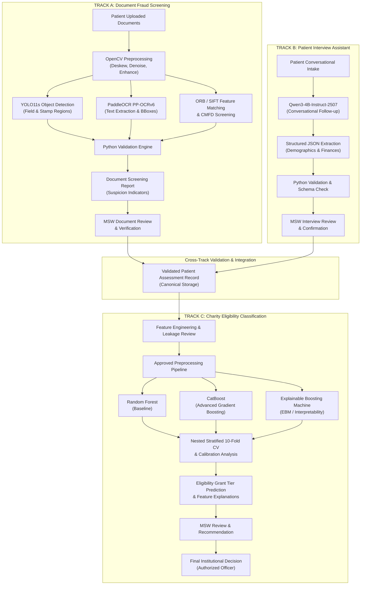

# OFPHIL System Architecture: Multimodal Machine Learning Pipeline

## 1. Executive Summary & Architecture Paradigm

The OFPHIL classification system establishes a rigorous, three-track artificial intelligence and decision-support architecture. The objective is to assist Medical Social Workers (MSWs) and healthcare administrators in evaluating charity patient eligibility for specialized ophthalmic surgical interventions.

---

## 2. Three Independent Processing Modules

### Module A: Document Fraud Screening
* **Purpose:** Detect document visual structure, extract printed textual fields, and screen for potential image alterations or copy-move duplications.
* **Core Components:**
  1. **OpenCV:** Image deskewing, denoising, contrast enhancement, and visual consistency checks.
  2. **YOLO11s:** Region and element detection (patient info fields, dates, diagnosis/findings, tables, signatures, stamps).
  3. **PaddleOCR (PP-OCRv6):** Text transcription with bounding box coordinates and confidence levels.
  4. **ORB / SIFT:** Keypoint detection and descriptor matching for visual stamp comparison and duplicate region screening.
  5. **Copy-Move Forgery Detection (CMFD):** Block-based and keypoint-based screening for duplicated regions within the same document.
  6. **Python Validation Engine:** Cross-checks OCR extracted dates, reference numbers, and expected element geometry against registered patient identity.
* **Strict Safety Boundaries:**
  - YOLO11s detects the presence of signatures and stamps; it does **not** authenticate them.
  - Siamese comparison networks are explicitly excluded.
  - Fraud screening generates suspicion flags; it **never** automatically disqualifies a patient.

### Module B: LLM-Powered Patient Interview Assistant
* **Purpose:** Assist caseworkers during intake interviews in Filipino and English, formulate contextual follow-up questions, and convert dialogue into structured JSON.
* **Core Components:**
  1. **Qwen3-4B-Instruct-2507:** Local open-weights model executed via Ollama or llama.cpp.
  2. **Prompt Engineering & Structured Extraction:** Specialized templates enforcing schema adherence for household, income, and demographic fields.
  3. **Python Assessment Validator:** Validates schema bounds, data types, and required fields before persistence.
* **Strict Safety Boundaries:**
  - The LLM does **not** compute eligibility, assign grant tiers, diagnose medical conditions, or score psychosocial risk.
  - All extracted data requires explicit MSW verification before entering the permanent patient dossier.

### Module C: Charity Patient Eligibility Classification
* **Purpose:** Supervised tabular decision support to predict patient eligibility category and grant subsidy tier.
* **Active Model Comparison:**
  1. **Random Forest (RF):** Standard non-linear ensemble baseline.
  2. **CatBoost:** Advanced categorical and numerical gradient boosted decision trees.
  3. **Explainable Boosting Machine (EBM):** Generalized Additive Model with pairwise interactions ($GA^2M$) providing exact feature-level contribution curves.
* **Model Exclusion:** Logistic Regression is excluded from active model selection due to extreme class-boundary distortion and non-linear feature interactions.
* **Methodology:** Nested Stratified 10-Fold Cross-Validation, strict train/validation isolation, threshold calibration, Brier score analysis, and ROC-AUC assessment.

---

## 3. Phase Alignment (Preserving Existing Six-Phase Structure)

1. **Phase 02 (Data Preparation):** Tabular data cleaning, missing value imputation, taxonomy alignment, and ground-truth transcriptions.
2. **Phase 03 (Feature Engineering):** Socioeconomic ratio derivations, per-capita income transformations, target leakage prevention, and schema enforcement.
3. **Phase 04 (Document Processing and OCR):** YOLO11s region detection, PaddleOCR text extraction, ORB/SIFT feature analysis, CMFD forgery screening, and CER/WER error optimization.
4. **Phase 05 (Model Selection, Training, Evaluation, and LLM Development):** RF, CatBoost, and EBM tabular model comparison and Qwen3-4B interview assistant integration.
5. **Phase 06 (Model Artifacts, Reporting, and Final Integration):** Model serialization, interpretability dashboards, audit manifests, and backend synchronization.
