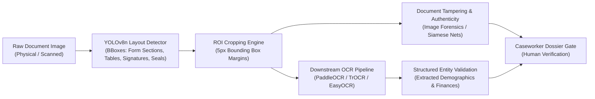

# YOLO Version & Implementation Specification

**Project**: `ofphil-classification-v2`  
**Phase**: Phase 04 – Document Processing & OCR (`03_yolo_document_detection`)  
**Architecture**: **Ultralytics YOLOv8n (YOLOv8 Nano)**  
**Task**: Object Detection (Document Layout & Region Segmentation)  
**Pretrained Weights**: `yolov8n.pt`  
**Status**: **IMPLEMENTED & CONFIGURED FOR MANUAL EXECUTION**

---

## 1. Official Architecture Lock

To maintain strict scientific comparability and adhere to the project research methodology:
- **Canonical Architecture**: Ultralytics **YOLOv8n (Nano)**.
- **Model File**: `yolov8n.pt` (approx. 6.2 MB parameter checkpoint; 3.2M parameters; 8.7 GFLOPs).
- **Prohibited Upgrades**: YOLOv8n must **not** be replaced with YOLOv9, YOLOv10, YOLOv11, YOLOv12, YOLO26, or larger parameter variants (s/m/l/x) without explicit authorized experimental design revisions.
- **Separation of Architecture vs Package**:
  - The *architecture* is **YOLOv8 Nano**.
  - The *software framework* is the **Ultralytics library** (`ultralytics`). Package updates do not alter the underlying model definition.

---

## 2. Document Processing Pipeline Role & Governance Boundaries

YOLOv8n performs structural layout segmentation on patient supporting documents (e.g., Barangay Certificates of Indigency, Hospital Bill Quotations, Clinical Referrals, PhilHealth MDRs):

### Critical Governance Boundaries:
1. **Zero Eligibility Prediction**: YOLO detects spatial bounding boxes only; it does not assign charity categories (`CHARITY` / `PAYING`).
2. **Zero Authenticity Determination**: YOLO identifies where a seal or signature is located. Authenticity verification is delegated to `06_document_tampering_detection` and the human MSW.
3. **Downstream Feeding**: Detected regions of interest (ROIs) are cropped with a 5px margin and supplied directly to OCR engines for high-accuracy localized character recognition.

---

## 3. Workflow Mapping Across the Five Phase 04 Notebooks

The five notebooks in `experiments/notebooks/04_document_processing_and_ocr/03_yolo_document_detection/` are fully implemented and staged:

1. **`01_yolo_document_dataset_preparation.ipynb`**:
   - Reads ground-truth annotations from `data/interim/document_processing/ground_truth_annotations/text_detection_annotations.csv`.
   - Uses `document_level_split_manifest.json` to assign documents to `train`, `val`, or `test` partitions.
   - Normalizes coordinates into standard YOLO format: `class_id x_center y_center width height`.
   - Emits the master `data.yaml` dataset descriptor.
2. **`02_yolo_annotation_and_label_validation.ipynb`**:
   - Audits all emitted `.txt` label files for syntax validity, token counts (exactly 5 tokens/line), coordinate range invariants ($0.0 \le x_c, y_c, w, h \le 1.0$), and class ID bounds.
   - Outputs a non-blocking verification report to `data/interim/validated/yolo_annotation_audit.json`.
3. **`03_yolo_model_training.ipynb`**:
   - Formulates the Ultralytics API training routine with seed `20261123`, deterministic mode, early stopping (`patience=15`), and configurable checkpoints.
   - Exports `training_hyperparameters.yaml` into `models/document_processing/yolo/`.
4. **`04_yolo_model_evaluation.ipynb`**:
   - Implements evaluation harness computing Precision ($MP$), Recall ($MR$), $mAP@0.5$, and $mAP@0.5:0.95$ on held-out test splits.
   - Structures output report schema in `yolo_test_evaluation_report.json` without fabricating metrics prior to execution.
5. **`05_yolo_inference_and_region_extraction.ipynb`**:
   - Implements `extract_element_crops` with bounding box margin expansion.
   - Provides `detect_and_extract_regions` to bridge live YOLO predictions into downstream OCR engines.
